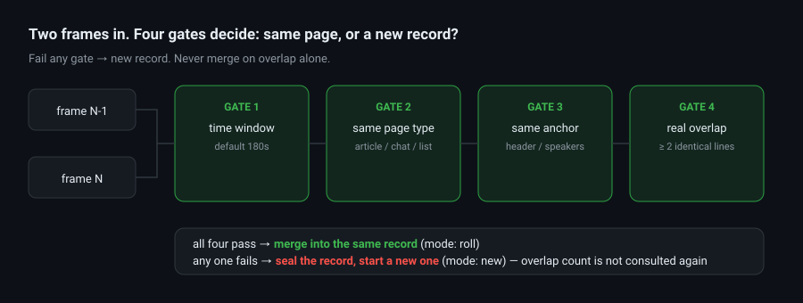

# ScrollBreaker

[](https://pypi.org/project/scrollbreaker/)
[](https://pypi.org/project/scrollbreaker/)
[](LICENSE)
[](tests/)

**A scroll-aware screen content collector for LLM agents.** The collector that asks
whether two captures are the same page — instead of assuming they are.

> **Your LLM is eating garbage, and the splicing is the problem.**
>
> Every scroll-capture tool on the planet merges frames by line overlap. That works —
> until it silently fuses an article and a group chat into one record that looks
> perfectly normal, parses fine, embeds fine, and is **wrong**.
> Nothing downstream will ever warn you.



## 30 seconds

```bash
pip install scrollbreaker            # zero runtime dependencies, Python 3.10+
scrollbreaker replay examples/frames.jsonl
```

Real output from that command — this is the whole idea in three lines:

```
合计 2 条新页 / 1 次合并
frame 1  new   chat     anchor=张三|李四     gate: same_type=false
frame 2  roll  chat     anchor=张三|李四     overlap=2   <- same conversation, merged
frame 3  new   article  anchor=如何理解滚动采集  gate: same_type=false  <- page switched, hard break
```

Frame 3 shares text with frame 2 and a naive tool would staple them together.
ScrollBreaker seals the chat record and starts a new one, because the page type changed.

## Who this is for

- **Agent builders** feeding screen content into an LLM, who keep getting summaries that
  mix two unrelated things.
- **Anyone running OCR → merge pipelines** (screenshot every N seconds, then stitch).
- **Android screen collectors** — `android/` ships the phone half: capture → dHash dedup →
  privacy gate → POST to an endpoint you control.

It is *not* a screen recorder, a database scraper, or a way around any app's protection.
It reads only what is visible, and stays local.

Most **information collectors** answer the question *"how do I grab the screen?"*
ScrollBreaker answers the harder one: *"are these two grabs the same page at all?"*


Screenshot → OCR → merge is the standard pipeline for feeding visual content to an
agent. It has one failure mode that poisons your dataset and never warns you:
**unrelated pages that happen to share lines.**

```
Article page : 正常 / 好的 / 收到 / 在看 / +关注 / body paragraph...
Chat page    : 正常 / 好的 / 收到 / Alice: stop machine 4 / Bob: on it
Shared lines : 3
```

Any tool that merges on "overlap ≥ 2" fuses these two. The result is one record
containing an article with a factory conversation stapled into its middle. It parses
fine. It embeds fine. It is **wrong**, and nothing downstream will tell you.

ScrollBreaker refuses to merge unless four gates all pass.

## The four gates

| # | Gate | Rule | Default |
|---|------|------|---------|
| 1 | Time window | Frames further apart than N seconds are a different reading session | `180s` |
| 2 | Same type | `article` / `chat` / `list` / `text` must match | — |
| 3 | Same anchor | Same page header (relaxed for articles — titles scroll away) | — |
| 4 | Real overlap | ≥ N **identical** lines, because 1 line is noise | `2` |

Fail any one → **new record, no merge. Ever.**

## Install

Three ways, pick one:

```bash
pip install scrollbreaker                                  # PyPI, newest
pip install https://github.com/xiangjianhuan007/scrollbreaker/releases/download/v0.1.0/scrollbreaker-0.1.0-py3-none-any.whl   # pinned wheel
git clone https://github.com/xiangjianhuan007/scrollbreaker && cd scrollbreaker && pip install -e ".[dev]"                   # hack on it
```

Verify the install the same way CI does:

```bash
scrollbreaker --version
scrollbreaker replay examples/frames.jsonl
```

Zero runtime dependencies. The `image` extra (`pillow`, `mss`) is only needed if you
want to feed it real screenshots instead of OCR'd text.


There is a fifth state, `mixed`: a frame containing both article and chat/list
signatures. That frame *is* a page transition in progress, so it can neither start
an accumulation nor be absorbed into one.

## Quick start

```bash
pip install -e .
# for live capture: pip install mss pillow
```

```python
from scrollbreaker import Accumulator, Frame, Mode

acc = Accumulator()                      # every threshold lives in Config

for snap in screenshots:                 # one frame every N seconds
    m = acc.push(Frame(lines=snap.lines, ts=snap.ts))

    if m.mode is Mode.ROLL:
        pass                             # same page scrolling; m.text is the full text
    else:
        handle_page(m.text)              # page changed; previous record is complete
```

Every decision is auditable — `m.gate_log` tells you which gate failed:

```python
{"time_window": True, "same_type": False, "same_anchor": False,
 "anchor_relaxed": True, "overlap_enough": False}
```

### CLI

```bash
# offline replay — tune thresholds without capturing anything
scrollbreaker replay examples/frames.jsonl

# live capture
scrollbreaker watch --interval 10 \
  --ocr-cmd tesseract {img} stdout -l eng --psm 6 \
  --output records.jsonl
```

Real output, one JSON record per decision (trimmed):

```json
{"frame": 2, "mode": "roll", "page": "chat", "anchor": "张三|李四", "overlap": 2, "lines": 4,
 "gate": {"time_window": true, "same_type": true, "same_anchor": true, "overlap_enough": true}}
{"frame": 3, "mode": "new", "page": "article", "anchor": "如何理解滚动采集，很多人以为", "overlap": 0, "lines": 3,
 "gate": {"time_window": true, "same_type": false, "same_anchor": false, "anchor_relaxed": true, "overlap_enough": false}}
```

Frame 3 is the whole point: **wrong type, no merge — no matter the overlap.**


## Android capture app (optional)

`android/` contains the phone half of the pair: interval screen capture → dHash
dedup → refuse password/payment screens → POST the frame to an endpoint you control.

It is source, not a shipped app — you build it yourself, and **nothing leaves the
device until you enter an endpoint**. Requires Android 11+ (API 30) because
`AccessibilityService.takeScreenshot()` is the only unattended capture API.

```
android/          769 lines Kotlin, zero dependencies
  CaptureService.kt   the loop + the four gates + the privacy gate
  ImageSig.kt         dHash + blank detection
  Uplink.kt           one POST, no SDK
  CaptureConfig.kt    everything configurable, nothing hard-coded
  MainActivity.kt     settings screen (built in code, no layouts)
```

See [android/README.md](android/README.md) for the permission trade-off, the payload
shape and a 10-line receiver.


## Output shape

```json
{"ts": 1000.0, "mode": "roll", "page": "chat", "anchor": "Alice|Bob",
 "scene": "chat|Alice|Bob", "overlap": 2, "text": "..."}
```

`scene` is the field that matters downstream. Group by `scene` when you store,
embed, or summarize, and unrelated captures can no longer contaminate each other.

## Design trade-offs

**OCR is a plug-in.** The whole contract is `read(bytes) -> str`. Use tesseract,
PaddleOCR, a cloud API, a local VLM — ScrollBreaker never looks at pixels, only lines.

**Screen only, no database spelunking.** No file parsing, no process injection,
no root. You lose some fidelity versus reading the source directly; you gain
application-agnostic capture that survives app updates.

**Thresholds are empirical, not laws.** `180s / 80 lines / 2 overlap` came from real
long-form reading and group-chat scrolling. Monitoring a dashboard or a log tail?
Change `Config`.

**Chat anchors degrade gracefully.** A chat header scrolls out of view, at which point
the first line is a message, not a header. ScrollBreaker falls back to the set of
speakers seen in the frame — stable within a conversation, rarely shared across two.

## Test suite

```bash
pip install -e ".[dev]" && pytest -q
```

9 tests covering each gate. The one that matters is `test_article_to_chat_never_merged`:
two frames sharing **6 lines** with different page types must still produce two records.
It exists because that exact fusion happened and corrupted real data. Run it before
touching the merge logic.

## Compliance

- Reads **only what is visible on screen**. No application data files, no databases,
  no process memory.
- **No network, no telemetry.** Everything stays local; output is a JSONL on your disk.
- Capturing other people's screens, or redistributing captured content, may violate
  local law and the target platform's terms. **Use it on your own device, your own
  account, your own visible content.**
- This project provides no authentication bypass, no database decryption, and no
  process injection — and will not accept PRs that add them.

## 中文说明

**ScrollBreaker（破滚者）** —— 把滚动的屏幕切成能读的页，而不是糊成一坨。

核心不是「截图 + OCR」，是**判断两屏到底是不是同一页**。绝大多数采集工具按「有两行
重合」就拼，于是把一篇文章和一段群聊糊成一条记录——解析正常、向量化正常，但内容是
错的，而且下游永远不会报警。ScrollBreaker 用四道闸门挡住这种污染。

```bash
pip install scrollbreaker
scrollbreaker replay examples/frames.jsonl   # 离线回放，不用真截图就能看判定结果
```

四道闸门（时间窗 / 类型一致 / 页头一致 / 实质重合）全部通过才允许合并，任一条不过
就果断断开。`mixed`（一屏里同时出现文章和聊天特征）是切页中间态，既不累积也不被吸收。
每个判定都留 `gate_log`，哪一道没过一目了然。

适用：给 LLM 喂屏幕内容的 Agent、按固定间隔截图再拼接的采集流水线、安卓端屏幕采集
（`android/` 里有手机那一半：采集 → dHash 去重 → 隐私闸门 → POST 到你自己的端点）。

不适用：录屏、扒数据库、绕过任何 App 的保护。它只读屏幕上看得见的东西，全程本地、
不联网、不上报。

阈值都在 `Config` 里，改成你的场景就行。

## License

MIT — do whatever you want, just don't blame us when your OCR is worse than ours.
